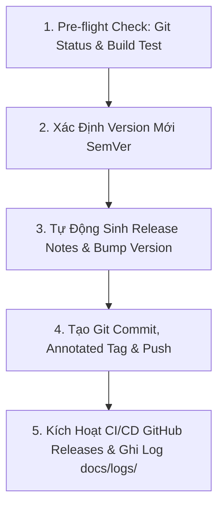

# 🚀 Deploy App Skill - Quy Trình Phát Hành Phiên Bản Mới

Skill này cung cấp quy trình tự động hóa toàn diện từ kiểm tra biên dịch, tự động nâng phiên bản (Semantic Versioning) trong `app/build.gradle.kts`, tạo Git Tag annotated và đẩy lên GitHub để kích hoạt GitHub Actions (`.github/workflows/release.yml`) tự động build và xuất bản APK phục vụ cơ chế tự động cập nhật trong ứng dụng (In-app Auto-Update).

---

## ⚡ Quy Trình 5 Bước Phát Hành Chuẩn



---

### Bước 1: Kiểm Tra Trước Phát Hành (Pre-flight Checks)
1. Đảm bảo toàn bộ thay đổi mã nguồn trước đó đã được commit hoặc ở trạng thái sạch.
2. Kiểm tra biên dịch bằng lệnh:
   ```powershell
   .\gradlew.bat compileDebugKotlin
   ```
   *(Đảm bảo kết quả BUILD SUCCESSFUL trước khi tiến hành).*

---

### Bước 2: BẮT BUỘC - Khởi Tạo Log Truy Vết (`docs/logs/`)
Trước khi thực hiện release, tạo bản ghi nhật ký:
```powershell
powershell -ExecutionPolicy Bypass -File .agents/skills/swarm-dispatch/scripts/init_log.ps1 -TaskSlug "release_v<version>" -TaskTitle "Phát hành phiên bản ứng dụng v<version>" -AgentName "lead-architect"
```

---

### Bước 3: Thực Hiện Deploy Bằng Script Tự Động (`scripts/deploy.ps1`)

Sử dụng script tiện ích tự động hóa các thao tác cập nhật `app/build.gradle.kts`, sinh Release Notes, commit, tạo tag và đẩy lên GitHub:

#### 1. Phát hành bản vá lỗi (Patch: 1.0.0 -> 1.0.1)
```powershell
powershell -ExecutionPolicy Bypass -File .agents/skills/deploy-app/scripts/deploy.ps1 -BumpType patch -ReleaseTitle "Vá lỗi và cải thiện độ ổn định"
```

#### 2. Phát hành bản tính năng mới (Minor: 1.0.0 -> 1.1.0)
```powershell
powershell -ExecutionPolicy Bypass -File .agents/skills/deploy-app/scripts/deploy.ps1 -BumpType minor -ReleaseTitle "Bổ sung tính năng mới" -ReleaseNotes "- Tối ưu hóa biểu đồ sóng Canvas 120 FPS`n- Nâng cấp bộ phân tích Traceroute"
```

#### 3. Chạy thử nghiệm không ghi đĩa (Dry Run)
```powershell
powershell -ExecutionPolicy Bypass -File .agents/skills/deploy-app/scripts/deploy.ps1 -BumpType patch -DryRun -SkipTest
```

#### Các tham số của script `deploy.ps1`:
| Tham số | Ý nghĩa | Mặc định |
| :--- | :--- | :--- |
| `-BumpType` | Loại nâng cấp: `patch`, `minor`, `major`, `custom` | `patch` |
| `-CustomVersion` | Phiên bản chỉ định thủ công khi dùng `custom` (VD: `1.2.0`) | `""` |
| `-ReleaseTitle` | Tiêu đề cho bản phát hành | Tự động |
| `-ReleaseNotes` | Nội dung mô tả chi tiết các thay đổi | Tự động trích xuất từ git log |
| `-DryRun` | Chạy mô phỏng, không ghi đè file, không commit hay push | `$false` |
| `-SkipTest` | Bỏ qua bước chạy kiểm tra biên dịch trước khi deploy | `$false` |
| `-SkipPush` | Chỉ commit và tạo tag cục bộ, không push lên GitHub | `$false` |

---

### Bước 4: Kiểm Tra Tự Động Hóa CI/CD & GitHub Releases
1. Khi script đẩy tag `v*` (ví dụ `v1.0.1`) lên GitHub:
   - Workflow [`.github/workflows/release.yml`](../../.github/workflows/release.yml) sẽ tự động kích hoạt trên GitHub Actions.
   - Hệ thống tự động build file APK và tải đính kèm vào mục **Releases** của repository: `https://github.com/khuongnv/ping/releases`.
2. Kiểm tra trên ứng dụng: Mở màn hình **Cài đặt**, ứng dụng sẽ tự động truy vấn API và hiển thị thông báo bản cập nhật mới kèm changelog và nút tải về trực tiếp.
