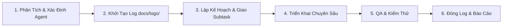

# 🐝 Swarm Dispatch Skill - Quy Trình Giao Việc & Điều Phối Swarm

Skill này hướng dẫn quy trình tiêu chuẩn để tiếp nhận yêu cầu từ người dùng, phân rã nhiệm vụ, giao việc cho các Swarm Subagents chuyên trách, giám sát chất lượng và tự động duy trì nhật ký truy vết (`docs/logs/*.md`).

---

## ⚡ Quy Trình 6 Bước Giao Việc & Thực Thi



---

### Bước 1: Tiếp Nhận & Phân Luồng Yêu Cầu
1. Đọc kỹ yêu cầu từ người dùng (`USER_REQUEST`).
2. Tra cứu [Ma Trận Điều Phối (Dispatch Matrix)](./references/dispatch_matrix.md) để xác định Agent chủ trì và các Agent phối hợp:
   - **`network-engine-specialist`**: Ping ICMP, Traceroute, phân tích log dòng lệnh, thống kê RTT, tính % loss gói tin, tham số timeout/packet size.
   - **`compose-ui-specialist`**: Giao diện Compose, Liquid Glass, Thẻ bán trong suốt, Bottom Bar nổi, Biểu đồ sóng Canvas, Terminal Log Panel.
   - **`device-network-specialist`**: Wi-Fi info (SSID, Gateway, DNS, Subnet), Public IP & ISP API lookup, GitHub Auto-update manager.
   - **`qa-perf-specialist`**: Kiểm thử không rò rỉ tiến trình ICMP, tối ưu RAM biểu đồ sóng Canvas, pin Doze mode, Gradle build & release.
   - **`lead-architect`**: Tính năng lớn toàn diện, tái cấu trúc mã nguồn, nâng cấp ViewModel hoặc luồng dữ liệu chính.

---

### Bước 2: BẮT BUỘC - Khởi Tạo Nhật Ký Truy Vết (`docs/logs/`)
> [!IMPORTANT]
> Tuyệt đối không bắt tay vào sửa mã nguồn khi chưa khởi tạo file log truy vết.

Chạy lệnh PowerShell sau để tự động tạo tệp log và cập nhật chỉ mục [`docs/logs/README.md`](../../docs/logs/README.md):
```powershell
powershell -ExecutionPolicy Bypass -File .agents/skills/swarm-dispatch/scripts/init_log.ps1 -TaskSlug "<slug_ngan_gon>" -TaskTitle "<Tên_nhiệm_vụ>" -AgentName "<ten_agent>"
```
*Ví dụ*:
```powershell
powershell -ExecutionPolicy Bypass -File .agents/skills/swarm-dispatch/scripts/init_log.ps1 -TaskSlug "enhance_ping_chart" -TaskTitle "Nâng cấp hiệu ứng Canvas biểu đồ sóng Ping" -AgentName "compose-ui-specialist"
```
*(Nếu môi trường không chạy được script, tạo thủ công tệp `docs/logs/YYYY-MM-DD_<slug>.md` dựa theo [Log Template](./resources/log_template.md) và thêm dòng tương ứng vào `docs/logs/README.md`).*

---

### Bước 3: Phân Bổ Nhiệm Vụ (Subtask Allocation)
- Nếu là tác vụ đơn lẻ: Agent chủ trì trực tiếp triển khai.
- Nếu là tác vụ phức tạp liên tầng:
  - Triệu hồi `network-engine-specialist` phụ trách luồng ICMP / Traceroute.
  - Triệu hồi `compose-ui-specialist` phụ trách thành phần giao diện Compose.
  - Triệu hồi `device-network-specialist` phụ trách thông tin mạng / cập nhật.
  - Giao rõ ràng: Mục tiêu cần đạt, tệp tin cần sửa, kiểu dữ liệu truyền nhận.

---

### Bước 4: Triển Khai Chuyên Sâu & Đảm Bảo Tiêu Chuẩn Kỹ Thuật
Mỗi agent khi thực hiện phải tuân thủ:
1. **Kiến trúc MVVM & Unidirectional Data Flow**:
   - `ui` quan sát trạng thái qua `StateFlow` từ `PingViewModel`.
   - `data/engine` và `data/network` cung cấp dữ liệu qua Coroutine Flow hoặc hàm suspend.
2. **Quy chuẩn Liquid Glass & Apple Music HIG**:
   - Nền AMOLED `#000000`, viền phản quang `0.75dp`, bo góc cong mượt mà, chuyển động Spring Physics.
3. **Quản lý bất đồng bộ & Bộ nhớ**:
   - Mọi I/O trên `Dispatchers.IO`, cập nhật UI trên Main Thread.
   - Dọn dẹp tiến trình con và Stream khi Coroutine Scope bị hủy.

---

### Bước 5: Kiểm Thử & Đánh Giá Chất Lượng (QA Review)
Trước khi kết thúc, `qa-perf-specialist` (hoặc agent chủ trì) rà soát:
- Kiểm tra tính toàn vẹn của mã nguồn Kotlin.
- Chạy kiểm tra biên dịch bằng `./gradlew.bat compileDebugKotlin` hoặc `./gradlew.bat assembleDebug`.
- Rà soát nguy cơ rò rỉ tiến trình nền của lệnh `ping`.
- Kiểm tra danh sách điểm Canvas không vượt quá 60 - 100 điểm.

---

### Bước 6: Hoàn Thiện Log & Báo Cáo Kết Quả
1. Cập nhật nội dung chi tiết vào file log `docs/logs/YYYY-MM-DD_<slug>.md`:
   - Điền đầy đủ mục **2. Chi Tiết Các Bước Thực Hiện**.
   - Điền danh sách tệp thay đổi tại mục **3. Danh Sách Tệp Thay Đổi**.
   - Điền kết quả kiểm thử tại mục **4. Kiểm Thử & Xác Minh**.
   - Chuyển `Trạng thái: 🔄 Đang tiến hành` thành `Trạng thái: ✅ Hoàn thành`.
2. Cập nhật trạng thái thành `✅ Hoàn thành` trong [`docs/logs/README.md`](../../docs/logs/README.md).
3. Báo cáo tổng kết cho người dùng kèm các đường dẫn liên kết đến tệp mã nguồn và tệp log.
