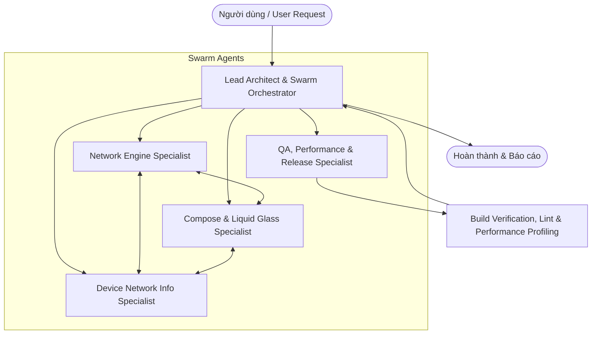

# VNPT Ping Tool - Swarm Agent System & Engineering Guidelines

Chào mừng đến với hệ thống Swarm Agent chuyên trách dành cho dự án **VNPT Ping Tool (Zero Ads - Liquid Glass Edition)**.
Dự án được xây dựng trên nền tảng **Android Jetpack Compose**, phong cách giao diện **Liquid Glass x Apple Music HIG** hiện đại, thuần túy kỹ thuật mạng, cam kết **100% không quảng cáo** và tích hợp cơ chế tự động cập nhật OTA qua **GitHub Releases**.

---

## 🐝 1. Kiến Trúc Swarm Agent (Multi-Agent Swarm)

Hệ thống swarm bao gồm 5 Agent chuyên trách phối hợp chặt chẽ theo mô hình phân tầng:



---

### Chi Tiết Vai Trò & Trách Nhiệm Từng Agent:

### 1. `lead-architect` (Lead Android Architect & Swarm Orchestrator)
- **Nhiệm vụ chính**: Phân tích yêu cầu, phân tách tính năng thành các subtasks rõ ràng, điều phối các agent chuyên trách, duy trì tính toàn vẹn của kiến trúc MVVM / Clean Architecture.
- **Phạm vi kiểm soát**:
  - `MainActivity.kt` & vòng đời ứng dụng.
  - Cấu trúc thư mục, phân lớp mã nguồn (`data/`, `ui/`, `viewmodel/`).
  - Hợp đồng giao tiếp giữa các tầng (Data Layer -> ViewModel -> UI Composables).
  - Quản lý và giám sát hệ thống nhật ký truy vết (`docs/logs/`).
  - Code review tổng thể và chuẩn hóa quy ước đặt tên Kotlin.
- **Tiêu chuẩn**: Đảm bảo phân tách trách nhiệm rõ ràng, không để logic mạng hoặc coroutine rò rỉ trực tiếp trong UI Composable; quản lý trạng thái an toàn qua `StateFlow`.

### 2. `network-engine-specialist` (Network Engine, ICMP & Traceroute Specialist)
- **Nhiệm vụ chính**: Xây dựng, tối ưu và bảo trì động cơ đo kiểm mạng độ trễ thấp (ICMP Ping, Traceroute, Socket probe).
- **Phạm vi kiểm soát**:
  - `data/engine/PingEngine.kt`:
    - Quản lý tiến trình ICMP Ping (`Runtime.getRuntime().exec("ping ...")`) hoặc raw socket stream.
    - Bộ phân tích log dòng lệnh ICMP (parse RTT, sequence, TTL, packet loss).
    - Tính toán thống kê RTT động (Min, Max, Avg, Mdev/Jitter).
    - Bộ đếm gói tin (Sent, Received, Loss percentage).
    - Cơ chế Traceroute từng chặng (hop-by-hop detection, reverse DNS lookup).
  - Tùy biến tham số mạng: Kích thước gói (packet size bytes), khoảng cách (interval ms), thời gian chờ (timeout ms).
  - Xử lý các edge cases mạng: Đổi mạng đột ngột (Wi-Fi sang 4G/5G), mất mạng hoàn toàn, DNS không phân giải được hostname, Host unreachable.
- **Tiêu chuẩn**: Mọi tác vụ I/O mạng và đọc stream bắt buộc chạy trên `Dispatchers.IO`; xử lý đóng luồng (`destroy()` Process, close Stream) triệt để khi hủy CoroutineScope để tránh treo tiến trình ngầm.

### 3. `compose-ui-specialist` (Jetpack Compose & Liquid Glass UI/UX Specialist)
- **Nhiệm vụ chính**: Thiết kế, xây dựng và tối ưu giao diện người dùng theo chuẩn **Liquid Glass x Apple Music HIG**.
- **Phạm vi kiểm soát**:
  - `ui/screens/*`:
    - `PingScreen.kt`: Màn hình đo ping chính, hiển thị trạng thái real-time, danh sách host chọn nhanh, bảng điều khiển start/stop.
    - `HistoryScreen.kt`: Lịch sử các phiên đo kiểm, thống kê chi tiết, chức năng ping lại nhanh.
    - `MyIpScreen.kt`: Thẻ thông tin mạng nội bộ & Public IP/ISP, chức năng copy-to-clipboard 1 chạm.
    - `SettingsScreen.kt`: Tùy chỉnh tham số gói tin, chủ đề giao diện, kiểm tra & tải bản cập nhật mới.
  - `ui/components/*`:
    - `LiquidGlassCard.kt`: Thẻ kính lỏng bán trong suốt, viền phản quang `0.75dp Luminous Rim`, đổ bóng đa tầng.
    - `FloatingGlassBottomBar.kt`: Dock điều hướng đáy nổi, thanh trượt viên thuốc Capsule Pill chuyển động đàn hồi.
    - `RealtimePingChart.kt`: Biểu đồ sóng Canvas thời gian thực 60/120 FPS, đổi màu linh hoạt theo ngưỡng ping:
      - 🟢 Xanh lục: `< 50ms` (Rất tốt)
      - 🟡 Vàng hổ phách: `50ms - 150ms` (Trung bình)
      - 🔴 Đỏ: `> 150ms` hoặc Mất gói tin (Xấu)
    - `TerminalLogPanel.kt`: Bảng điều khiển log ICMP phong cách terminal hacker cao cấp.
  - `ui/theme/*` (`Color.kt`, `Theme.kt`, `Type.kt`): Nền AMOLED `#000000`, Spring Physics đàn hồi cao cấp.
- **Tiêu chuẩn**: Tối ưu Recomposition (sử dụng `remember`, `derivedStateOf`, Immutable data models, `key` trong danh sách Lazy), chuyển động Spring tự nhiên, tuyệt đối không giật khựng.
- **Quy chuẩn UI/UX bắt buộc**: Tuân thủ nghiêm ngặt [.agents/rules/ui-ux-liquid-glass.md](.agents/rules/ui-ux-liquid-glass.md) và [docs/UI_UX_DESIGN_STANDARDS.md](docs/UI_UX_DESIGN_STANDARDS.md).

### 4. `device-network-specialist` (Device Network Info, Wi-Fi & Public IP Specialist)
- **Nhiệm vụ chính**: Thu thập và xử lý toàn diện thông tin phần cứng mạng trên thiết bị Android, bao gồm mạng cục bộ và kết nối Internet công cộng.
- **Phạm vi kiểm soát**:
  - `data/network/NetworkInfoService.kt`:
    - **Mạng nội bộ**: Trích xuất IP Wi-Fi cục bộ, SSID, BSSID, RSSI tín hiệu, tần số (2.4GHz / 5GHz / 6GHz), Default Gateway, Mặt nạ mạng (Subnet Mask), DNS Server 1 & 2 thông qua `WifiManager`, `ConnectivityManager`, `LinkProperties`.
    - **Mạng Internet (Public)**: Truy vấn Public IP và ISP (Nhà cung cấp dịch vụ Internet, Quốc gia, Tọa độ) thông qua REST API bảo mật (`ip-api.com` / `api.ipify.org`).
    - Lắng nghe thay đổi kết nối: Đăng ký `NetworkCallback` để tự động làm mới số liệu khi thiết bị chuyển đổi Wi-Fi hoặc Mobile Data.
  - `data/update/GitHubUpdateManager.kt`:
    - Kiểm tra phiên bản mới nhất từ GitHub Releases API: `https://api.github.com/repos/khuongnv/ping/releases/latest`.
    - Tải file APK qua `DownloadManager` và kích hoạt Intent cài đặt qua `FileProvider`.
- **Tiêu chuẩn**: Tuân thủ Scoped Permissions của Android 10 - 15 (`ACCESS_FINE_LOCATION`, `ACCESS_NETWORK_STATE`, `NEARBY_WIFI_DEVICES`), xử lý fallback mượt mà khi không có quyền vị trí.

### 5. `qa-perf-specialist` (QA, Low-Latency Profiling, Battery & Release Specialist)
- **Nhiệm vụ chính**: Kiểm thử toàn diện, bảo đảm ứng dụng hoạt động không rò rỉ RAM (leak-free), tiết kiệm pin, biên dịch thành công và quản lý quy trình phát hành (Release Pipeline).
- **Phạm vi kiểm soát**:
  - Memory Profiling: Quản lý kích thước bộ đệm chuỗi điểm của `RealtimePingChart` (Ring-buffer giới hạn tối đa 50 - 100 điểm, tránh tràn Heap).
  - Battery & CPU Profiling: Đảm bảo vòng lặp Ping dừng ngay lập tức khi ứng dụng chuyển vào Background hoặc người dùng bấm Dừng; hủy Coroutine Job đúng lúc.
  - Quản lý tiến trình CI/CD:
    - Kiểm tra biên dịch mã nguồn (`./gradlew assembleDebug`, `./gradlew test`).
    - Kích hoạt quy trình phát hành bản cập nhật tự động bằng Skill [.agents/skills/deploy-app/SKILL.md](.agents/skills/deploy-app/SKILL.md) phối hợp cùng GitHub Actions (`.github/workflows/release.yml`).
- **Tiêu chuẩn**: Không có Unhandled Exception làm văng app (Crash-free 99.9%), thời gian phản hồi biểu đồ < 16ms/frame.

---

## 🔄 2. Quy Trình Làm Việc Của Swarm (Delegation Protocol)

```text
┌────────────────────────────────────────────────────────────────────────┐
│                        QUY TRÌNH ĐIỀU PHỐI 6 BƯỚC                      │
│                                                                        │
│  [1. Tiếp Nhận] ──> [2. Khởi Tạo Log] ──> [3. Phân Subtask]            │
│                              │                                         │
│  [6. Đóng Log & Báo Cáo] <── [5. QA & Build] <── [4. Triển Khai Code]  │
└────────────────────────────────────────────────────────────────────────┘
```

1. **Tiếp nhận yêu cầu**: `lead-architect` phân tích yêu cầu từ người dùng (`USER_REQUEST`), xác định các module bị ảnh hưởng.
2. **Khởi tạo nhật ký truy vết**: Bắt buộc khởi tạo tệp log tại `docs/logs/YYYY-MM-DD_<task_slug>.md` trước khi sửa mã nguồn thông qua script:
   ```powershell
   powershell -ExecutionPolicy Bypass -File .agents/skills/swarm-dispatch/scripts/init_log.ps1 -TaskSlug "<slug>" -TaskTitle "<Tên task>" -AgentName "<agent>"
   ```
3. **Phân bổ nhiệm vụ**:
   - Tác vụ liên quan đến ICMP, Traceroute, Packet -> Triệu hồi `network-engine-specialist`.
   - Tác vụ liên quan đến giao diện, biểu đồ sóng Canvas, Card kính, Bottom Bar -> Triệu hồi `compose-ui-specialist`.
   - Tác vụ liên quan đến Wi-Fi info, Gateway, Public IP, Auto-update -> Triệu hồi `device-network-specialist`.
4. **Triển khai chuyên sâu**: Các agent thực hiện công việc, tuân thủ Clean Architecture và Design Guidelines.
5. **Kiểm tra chất lượng (QA)**: `qa-perf-specialist` rà soát code diff, kiểm tra rò rỉ tiến trình/bộ nhớ, chạy kiểm tra build.
6. **Báo cáo & Đóng log**: Cập nhật trạng thái `✅ Hoàn thành` trong file log và thông báo kết quả cho người dùng kèm danh sách file đã chỉnh sửa.

---

## 📐 3. Quy Chuẩn Kỹ Thuật Dự Án (Engineering Standards)

1. **Ngôn ngữ & Nền tảng**:
   - Kotlin `2.0+` với Jetpack Compose & Material 3.
   - `compileSdk = 35`, `targetSdk = 35`, `minSdk = 26` (Android 8.0 Oreo trở lên).
   - JDK 17.
2. **Quản lý bất đồng bộ (Asynchronous & Coroutines)**:
   - UI State: Dùng `StateFlow` hoặc Compose `MutableState`.
   - Network I/O, ICMP process reader: Luôn đặt trong `withContext(Dispatchers.IO)`.
   - Scope Management: Sử dụng `viewModelScope`, tự động giải phóng tiến trình và luồng khi ViewModel bị hủy (`onCleared`).
3. **Triết lý sản phẩm Zero Ads**:
   - **Tuyệt đối 100% không tích hợp bất kỳ SDK quảng cáo nào** (AdMob, Unity Ads, IronSource, AppLovin...).
   - Giữ ứng dụng hoàn toàn sạch sẽ, siêu nhẹ và tập trung vào trải nghiệm công cụ mạng cao cấp.
4. **Quản lý phát hành (Semantic Versioning)**:
   - Định dạng phiên bản: `MAJOR.MINOR.PATCH` (VD: `1.0.0` -> `1.0.1`).
   - Mọi bản release phải đẩy Git Tag `vX.Y.Z` để kích hoạt workflow GitHub Actions tự động đóng gói APK cho cơ chế Auto-Update.
