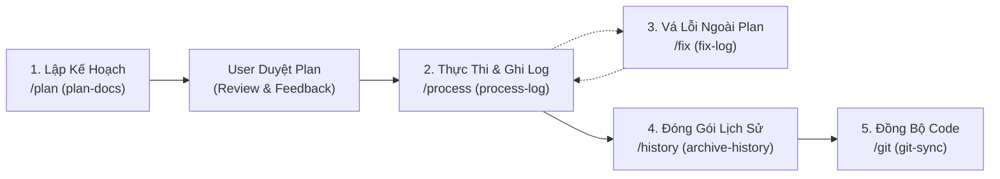

# HƯỚNG DẪN KHỞI TẠO HỆ THỐNG AGENTIC FRAMEWORK (.AGENTS, SKILLS, WORKFLOWS & DOCS) CHO DỰ ÁN MỚI

> **Mục đích:** File này là bộ khung tài liệu (Master Blueprint & Bootstrap Guide) dùng để đưa vào bất kỳ dự án phần mềm nào (Monorepo, Microservices, Fullstack, Frontend, Backend, Mobile...).
> Khi cung cấp file này cho AI Coding Assistant (như Google Antigravity, Claude, Cursor, Copilot...), AI sẽ tự động phân tích công nghệ của dự án mới và sinh ra toàn bộ hệ thống `.agents/`, các **Skills**, **Workflows** và cấu trúc tài liệu quản lý vòng đời phát triển phần mềm chuẩn mực.

---

## 1. PROMPT 1-CLICK DÀNH CHO AI AGENT Ở DỰ ÁN MỚI

> Copy đoạn prompt bên dưới dán vào ô chat của AI Agent trong dự án mới cùng với file này:

```text
Bạn là AI Coding Assistant chuyên trách kiến trúc dự án. Hãy đọc kỹ nội dung file `BOOTSTRAP_AGENTS.md` này.
Nhiệm vụ của bạn:
1. Phân tích cấu trúc thư mục, ngôn ngữ, framework (Backend, Frontend, Database, DevOps...) của dự án hiện tại.
2. Khởi tạo cấu trúc thư mục chuẩn:
   - `.agents/skills/` (chứa các skill tương ứng)
   - `.agents/workflows/` (chứa các workflow tương ứng)
   - `docs/rules/` (các quy tắc kiến trúc phù hợp với stack công nghệ của dự án)
   - `docs/plans/`, `docs/processes/`, `docs/fixes/`, `docs/history/` (thư mục rỗng kèm .gitkeep)
3. Tạo đầy đủ các file SKILL.md và file workflow markdown theo đúng mẫu chuẩn trong tài liệu này, điều chỉnh phù hợp với tech-stack của dự án hiện tại.
4. Báo cáo lại toàn bộ danh sách các file đã được khởi tạo.
```

---

## 2. TỔNG QUAN TRIẾT LÝ VÀ VÒNG ĐỜI AGENTIC DEVELOPMENT

Hệ thống quản lý phát triển phần mềm thông minh này phân tách rành mạch 5 giai đoạn cốt lõi:



### 3 Nguyên tắc an toàn bất khả xâm phạm:
1. **Giai đoạn Plan tuyệt đối không sửa code:** Khi gõ `/plan`, AI chỉ nghiên cứu, thiết kế và sinh tài liệu trong `docs/plans/`. Không được chạm vào mã nguồn hoặc chạy lệnh tác động môi trường.
2. **Không chạy lệnh can thiệp trực tiếp Database:** AI không tự chạy lệnh `INSERT`, `UPDATE`, `DELETE`, `ALTER` trực tiếp vào database người dùng. Mọi thay đổi DB phải được viết thành script SQL hoàn chỉnh trong file log để người dùng/DBA kiểm duyệt và chạy thủ công.
3. **Không tự động commit/push Git:** AI chỉ chuẩn bị commit note chi tiết, việc commit/push phải được người dùng kích hoạt qua lệnh rõ ràng (ví dụ `/git`).

---

## 3. CẤU TRÚC THƯ MỤC CHUẨN (TARGET DIRECTORY STRUCTURE)

```text
[PROJECT_ROOT]/
├── .agents/
│   ├── skills/
│   │   ├── plan-docs/
│   │   │   └── SKILL.md            # Skill lập kế hoạch trước khi code
│   │   ├── process-log/
│   │   │   └── SKILL.md            # Skill thực thi code và ghi nhật ký
│   │   ├── fix-log/
│   │   │   └── SKILL.md            # Skill xử lý bug ngoài plan và ghi log fix
│   │   ├── archive-history/
│   │   │   └── SKILL.md            # Skill đóng gói log thành bản history lâu dài
│   │   ├── git-sync/
│   │   │   └── SKILL.md            # Skill commit & push chuẩn hóa thông điệp
│   │   ├── issue-start/
│   │   │   └── SKILL.md            # Skill tạo nhánh feature/... chuẩn
│   │   ├── issue-finish/
│   │   │   └── SKILL.md            # Skill merge nhánh feature về developer
│   │   ├── (tùy chọn) export-metadata/
│   │   │   └── SKILL.md            # Trích xuất DDL/Schema Database
│   │   ├── (tùy chọn) export-data/
│   │   │   └── SKILL.md            # Trích xuất dữ liệu danh mục ra JSON/SQL
│   │   └── (tùy chọn) deploy-.../
│   │       └── SKILL.md            # Triển khai production / staging (Vercel, Docker...)
│   └── workflows/
│       ├── plan.md                 # Mapping lệnh /plan
│       ├── process.md              # Mapping lệnh /process
│       ├── fix.md                  # Mapping lệnh /fix
│       ├── history.md              # Mapping lệnh /history
│       ├── git.md                  # Mapping lệnh /git
│       └── ...
└── docs/
    ├── rules/                      # Quy tắc chuẩn mực dự án mà AI phải tuân theo
    │   ├── rule_database.md        # Chuẩn đặt tên bảng, cột, khóa, index, procedure
    │   ├── rule_backend.md         # Chuẩn RESTful API, Service, Repository, DTO, Auth
    │   ├── rule_frontend.md        # Chuẩn UI component, State, Forms, CSS/Theme
    │   └── rule_git_deployment.md  # Quy tắc branching, commit message, deploy
    ├── plans/                      # Nơi lưu trữ các file PLAN_YYYYMMDD_XX_...
    ├── processes/                  # Nơi lưu trữ các file PROCESS_YYYYMMDD_XX_...
    ├── fixes/                      # Nơi lưu trữ các file FIX_YYYYMMDD_XX_...
    └── history/                    # Nơi lưu trữ các bản tổng hợp HISTORY_YYYYMMDD.md
```

---

## 4. LỆNH KHỞI TẠO NHANH THƯ MỤC (INITIALIZATION SCRIPT)

### Trên Windows (PowerShell):
```powershell
# Tạo các thư mục .agents
New-Item -ItemType Directory -Force -Path ".agents/skills/plan-docs"
New-Item -ItemType Directory -Force -Path ".agents/skills/process-log"
New-Item -ItemType Directory -Force -Path ".agents/skills/fix-log"
New-Item -ItemType Directory -Force -Path ".agents/skills/archive-history"
New-Item -ItemType Directory -Force -Path ".agents/skills/git-sync"
New-Item -ItemType Directory -Force -Path ".agents/skills/issue-start"
New-Item -ItemType Directory -Force -Path ".agents/skills/issue-finish"
New-Item -ItemType Directory -Force -Path ".agents/workflows"

# Tạo các thư mục docs quản lý vòng đời
New-Item -ItemType Directory -Force -Path "docs/rules"
New-Item -ItemType Directory -Force -Path "docs/plans"
New-Item -ItemType Directory -Force -Path "docs/processes"
New-Item -ItemType Directory -Force -Path "docs/fixes"
New-Item -ItemType Directory -Force -Path "docs/history"

# Tạo file .gitkeep để giữ thư mục trong git
"" | Out-File "docs/plans/.gitkeep" -Encoding utf8
"" | Out-File "docs/processes/.gitkeep" -Encoding utf8
"" | Out-File "docs/fixes/.gitkeep" -Encoding utf8
"" | Out-File "docs/history/.gitkeep" -Encoding utf8
```

### Trên Linux / macOS (Bash):
```bash
mkdir -p .agents/skills/{plan-docs,process-log,fix-log,archive-history,git-sync,issue-start,issue-finish}
mkdir -p .agents/workflows
mkdir -p docs/{rules,plans,processes,fixes,history}
touch docs/plans/.gitkeep docs/processes/.gitkeep docs/fixes/.gitkeep docs/history/.gitkeep
```

---

## 5. NỘI DUNG MẪU CHI TIẾT TỪNG SKILL & WORKFLOW

### 5.1. Nhóm Kế Hoạch (Planning): `plan-docs` & `/plan`

#### File: `.agents/skills/plan-docs/SKILL.md`
```markdown
---
name: plan-docs
description: "Create implementation plans by Database, Backend, Frontend modules only. Use when user says /plan, lap ke hoach, viet tai lieu trien khai."
user-invocable: true
---

# Plan Docs

## Purpose
Create formal implementation plans before coding.

## Mandatory rule
- This skill only creates plan documents.
- Do not implement code or run process/fix actions in this step.

## Procedure
1. Analyze requested feature or bug scope.
2. Follow repository rules in `docs/rules/` during planning.
3. Create up to 3 files in `docs/plans/`:
   - `PLAN_YYYYMMDD_XX_DATABASE.md`
   - `PLAN_YYYYMMDD_XX_BACKEND.md`
   - `PLAN_YYYYMMDD_XX_FRONTEND.md`
4. Generate only impacted modules (do not create empty files).
5. Ask user to review and confirm plans before implementation.

## Required content by file
- DATABASE: schema/table changes, programmability (procedures, functions), rollback notes.
- BACKEND: DTO mapping, repository/service plan, API endpoint and auth plan.
- FRONTEND: state/services, routing/guards, UI components/forms plan.
```

#### File: `.agents/workflows/plan.md`
```markdown
---
description: Lập kế hoạch triển khai tính năng theo các module Database, Backend, Frontend
---

# Mục đích
Workflow này thiết lập nguyên tắc bắt buộc khi được yêu cầu "lên plan" (lập kế hoạch) hoặc "viết tài liệu triển khai".

# Quy tắc bắt buộc
- ⚠️ **KHI THỰC HIỆN SKILL NÀY: CHỈ ĐƯỢC PHÉP LÊN PLAN, TUYỆT ĐỐI KHÔNG SỬA CODE HOẶC CHẠY LỆNH GÂY BIẾN ĐỔI MÔI TRƯỜNG.**
- Phải đọc và tuân thủ các quy chuẩn trong `docs/rules/`.
- Phân tách kế hoạch thành tối đa 3 file riêng biệt cho các module bị ảnh hưởng:
  - `docs/plans/PLAN_YYYYMMDD_{XX}_DATABASE.md`
  - `docs/plans/PLAN_YYYYMMDD_{XX}_BACKEND.md`
  - `docs/plans/PLAN_YYYYMMDD_{XX}_FRONTEND.md`
  *(Trong đó `YYYYMMDD` là ngày hiện tại, `{XX}` là số thứ tự trong ngày như `01`, `02`).*

# Nội dung từng file
1. **DATABASE:** Tóm tắt thay đổi, thông tin bảng/cột mới, script tạo bảng/chỉnh sửa, Procedure/Function liên quan, Rollback script.
2. **BACKEND:** Nhiệm vụ của Backend, DTO Request/Response, Repository/Service Interfaces, API Controller routing & phân quyền.
3. **FRONTEND:** Mô tả trải nghiệm UI/UX, State/Service quản lý dữ liệu, Routing/Guards, Danh sách Component & Forms.

Sau khi tạo xong, nhắc người dùng kiểm tra và xác nhận trước khi thực hiện bước code tiếp theo.
```

---

### 5.2. Nhóm Thực Thi (Execution): `process-log` & `/process`

#### File: `.agents/skills/process-log/SKILL.md`
```markdown
---
name: process-log
description: "Implement code after approved plan and write PROCESS execution logs by module. Use when user says /process, thuc thi plan, ghi nhat ky thuc thi."
user-invocable: true
---

# Process Log

## Purpose
Implement approved plan and produce execution logs for traceability.

## Safety rules
- Never run direct DB mutation commands against user database.
- Provide SQL scripts in markdown logs for manual execution by user/DBA.
- Do not auto commit or auto push unless explicitly requested.

## Procedure
1. Implement code changes according to approved plan.
2. Follow repository rules in `docs/rules/` while coding.
3. Create only relevant files in `docs/processes/`:
   - `PROCESS_YYYYMMDD_XX_DATABASE.md`
   - `PROCESS_YYYYMMDD_XX_BACKEND.md`
   - `PROCESS_YYYYMMDD_XX_FRONTEND.md`
4. Report generated file paths to user.

## Required content
- DATABASE: runnable SQL blocks only (not long narrative) ready for execution.
- BACKEND: changed files, diff summary, impacted endpoints.
- FRONTEND: changed files, UI/logic steps, installed packages if any.
```

#### File: `.agents/workflows/process.md`
```markdown
---
description: Ghi log lại các bước thực thi và mã nguồn (Execution Log) theo 3 module Database, Backend, Frontend
---

# Mục đích
Workflow này được sử dụng SAU KHI đã lên kế hoạch (Plan) hoàn tất. Nhiệm vụ của AI là triển khai code và dùng lệnh `/process` để GHI LẠI NHẬT KÝ (LOG) chi tiết các bước đã sửa/tạo mới ứng với File Plan ban đầu.

# Quy tắc an toàn:
1. **KHÔNG can thiệp trực tiếp Database:** Cung cấp script SQL hoàn chỉnh trong file log để người dùng/DBA kiểm tra và chạy thủ công.
2. **KHÔNG tự động commit/push Git:** Mọi thao tác đẩy code phải do người dùng chủ động yêu cầu.
3. Ghi file nhật ký vào `docs/processes/` theo định dạng:
   - `PROCESS_YYYYMMDD_{XX}_DATABASE.md`
   - `PROCESS_YYYYMMDD_{XX}_BACKEND.md`
   - `PROCESS_YYYYMMDD_{XX}_FRONTEND.md`

# Nội dung từng file
- **DATABASE:** Chỉ chứa các khối lệnh SQL hoàn chỉnh (CREATE TABLE, ALTER, PACKAGE, PROCEDURE...), đóng vai trò là Run-Script.
- **BACKEND:** Danh sách file đã chỉnh sửa/tạo mới, tóm tắt thay đổi (diff log), các API Endpoint bị tác động.
- **FRONTEND:** Danh sách file thay đổi, chi tiết cập nhật UI/Logic, thư viện cài thêm (nếu có).
```

---

### 5.3. Nhóm Vá Lỗi Ngoài Plan: `fix-log` & `/fix`

#### File: `.agents/skills/fix-log/SKILL.md`
```markdown
---
name: fix-log
description: "Handle unexpected bug fixes and write FIX logs. Use when user says /fix, bug fix, hotfix, debug issue, patch loi ngoai plan."
user-invocable: true
---

# Fix Log

## Purpose
Track out-of-plan bug fixes and create formal FIX documents by module.

## Procedure
1. Analyze reported or discovered issue.
2. Follow repository rules in `docs/rules/` before and during implementation.
3. Apply the code/database script changes required by the fix.
4. Create only relevant log files:
   - `docs/fixes/FIX_YYYYMMDD_XX_DATABASE.md`
   - `docs/fixes/FIX_YYYYMMDD_XX_BACKEND.md`
   - `docs/fixes/FIX_YYYYMMDD_XX_FRONTEND.md`

## Required content
- DATABASE file: runnable SQL patch script and issue header.
- BACKEND file: issue/root cause, changed files, key diff summary.
- FRONTEND file: issue/root cause, changed files, implementation notes.

## Rules
- Do not create empty module files.
- Report file paths after finishing logs.
```

#### File: `.agents/workflows/fix.md`
```markdown
---
description: Workflow xử lý và ghi log khi fix lỗi (Bug Fix) không nằm trong Plan ban đầu
---

# Mục đích
Xử lý các phát sinh lỗi, hotfix nhanh trong quá trình phát triển không nằm trong kế hoạch ban đầu, đảm bảo mọi thay đổi đều được lưu vết đầy đủ.

# Hướng dẫn
1. Phân tích nguyên nhân gốc rễ (Root Cause) của lỗi.
2. Sửa mã nguồn và kiểm thử.
3. Tạo file ghi nhận trong `docs/fixes/`:
   - `FIX_YYYYMMDD_{XX}_DATABASE.md`
   - `FIX_YYYYMMDD_{XX}_BACKEND.md`
   - `FIX_YYYYMMDD_{XX}_FRONTEND.md`
4. Nội dung cần nêu rõ: Mô tả lỗi, nguyên nhân, danh sách file sửa và đoạn code vá lỗi.
```

---

### 5.4. Nhóm Đóng Gói Lịch Sử: `archive-history` & `/history`

#### File: `.agents/skills/archive-history/SKILL.md`
```markdown
---
name: archive-history
description: "Archive docs/plans, docs/processes, docs/fixes into one HISTORY file and clean source files. Use when user says /history, archive logs, tong hop lich su."
user-invocable: true
---

# Archive History

## Purpose
Consolidate plan/process/fix markdown logs into one long-term history file.

## Procedure
1. List and read all `.md` files in:
   - `docs/plans/`
   - `docs/processes/`
   - `docs/fixes/`
2. Group related files by date and sequence number.
3. Generate `docs/history/HISTORY_YYYYMMDD.md`.
4. Ask user confirmation before deleting source files.
5. Delete only markdown files in source folders, never delete folders.

## Mandatory rules
- Read every source markdown file before summarizing.
- If all source folders are empty, report and stop.
- If same-day history exists, create `_v2`, `_v3`, ... suffix.
- Summary must keep context, not raw full copy.
```

#### File: `.agents/workflows/history.md`
```markdown
---
description: Dọn dẹp và tổng hợp tất cả Plan, Process, Fix thành 1 bản History lưu trữ lâu dài
---

# Mục đích
Tránh tình trạng thư mục `docs/plans/`, `docs/processes/`, `docs/fixes/` bị phình to với hàng chục file sau nhiều ngày phát triển. Gom toàn bộ lại thành 1 file duy nhất `docs/history/HISTORY_YYYYMMDD.md`.

# Các bước thực hiện:
1. Quét toàn bộ file trong 3 thư mục `docs/plans/`, `docs/processes/`, `docs/fixes/`.
2. Đọc và tổng hợp có cấu trúc theo thứ tự dòng thời gian các module (Database -> Backend -> Frontend).
3. Ghi file tổng hợp `docs/history/HISTORY_YYYYMMDD.md`.
4. **Xin xác nhận từ người dùng** trước khi xóa các file con nguồn trong 3 thư mục trên.
```

---

### 5.5. Nhóm Quản Lý Mã Nguồn: `git-sync`, `issue-start`, `issue-finish`

#### File: `.agents/skills/git-sync/SKILL.md`
```markdown
---
name: git-sync
description: "Prepare Vietnamese commit notes, then commit and push. Use when user says /git, commit push, dong bo git, day code."
user-invocable: true
---

# Git Sync

## Purpose
Standardize final synchronization to remote repository.

## Procedure
1. Review changes with: `git status`.
2. Review newly created `PROCESS_...` and `FIX_...` logs if present.
3. Prepare Vietnamese messages:
   - Commit title (ngắn gọn, chuẩn nghiệp vụ).
   - Commit description (chi tiết các điểm thay đổi).
4. Execute:
   ```bash
   git add .
   git commit -m "<Tiêu đề commit tiếng Việt>" -m "<Chi tiết tiếng Việt>"
   git push
   ```
5. Báo cáo trạng thái đồng bộ cho người dùng.
```

#### File: `.agents/skills/issue-start/SKILL.md`
```markdown
---
name: issue-start
description: "Start a new issue/feature branch. Use when user says START [issue_name]."
user-invocable: true
---

# Issue Start

## Purpose
Standardize starting a new work item/issue branch from the latest developer branch.

## Procedure
1. Switch to developer and pull latest updates:
   ```bash
   git checkout developer
   git pull
   ```
2. Create and checkout a new branch with prefix `feature/`:
   ```bash
   git checkout -b feature/<issue_name>
   ```
3. Confirm branch status to the user.
```

#### File: `.agents/skills/issue-finish/SKILL.md`
```markdown
---
name: issue-finish
description: "Finish an issue by merging the feature branch into developer and deleting the local feature branch if successful. Use when user says FINISH [issue_name]."
user-invocable: true
---

# Issue Finish

## Purpose
Merge the completed feature branch into the developer branch and clean up local branch.

## Procedure
1. Verify feature branch changes are committed:
   ```bash
   git checkout developer
   git pull
   ```
2. Merge the feature branch into developer:
   ```bash
   git merge feature/<issue_name>
   ```
3. Push to origin:
   ```bash
   git push origin developer
   ```
4. If merge & push succeed without conflict, delete local branch:
   ```bash
   git branch -d feature/<issue_name>
   ```
5. Remind user of any database migration scripts needing manual run.
```

---

## 6. HƯỚNG DẪN XÂY DỰNG CÁC QUY TẮC KIẾN TRÚC TRONG `docs/rules/`

Mỗi dự án mới cần có 3-4 file quy tắc nền tảng đặt tại `docs/rules/` để AI luôn tuân thủ mỗi khi viết code:

1. **`docs/rules/rule_database.md`:**
   - Quy ước đặt tên bảng (viết hoa/viết thường, số ít/số nhiều, tiền tố phân hệ).
   - Quy ước khóa chính (ID, GUID, Sequence).
   - Quy ước Audit columns (`NGAY_TAO`, `NGUOI_TAO`, `NGAY_SUA`, `NGUOI_SUA`).
   - Nguyên tắc: Không viết raw SQL từ Backend lên DB mà phải qua Stored Procedure / View hoặc Repository ORM chuẩn.

2. **`docs/rules/rule_backend.md`:**
   - Cấu trúc các tầng kiến trúc (Controller -> Service -> Repository -> Data Access).
   - Chuẩn DTO Request / Response (`ApiResponse<T>`).
   - Cơ chế bảo mật, phân quyền (JWT, Role attributes, Permission filters).
   - Quy chuẩn xử lý ngoại lệ (Exception handling & Error responses).

3. **`docs/rules/rule_frontend.md`:**
   - Chuẩn UI/UX (Design system, Tailwind CSS, PrimeNG, Material...).
   - Quản lý trạng thái (Signals, NgRx, Redux, Pinia...).
   - Chuẩn cấu trúc thư mục Component (Core, Shared, Modules/Pages).
   - Chuẩn hóa thông báo (Toast, Dialog confirm, Loading state).

4. **`docs/rules/rule_git_deployment.md`:**
   - Luồng Branching (`developer`, `feature/*`, `hotfix/*`, `main`).
   - Quy ước định dạng Commit message tiếng Việt.
   - Các bước build và deploy (Docker, Vercel, CI/CD pipeline).

---

## 7. CÁC SKILL TÙY CHỌN MỞ RỘNG THEO DỰ ÁN (OPTIONAL SKILLS)

Tùy theo tính chất của dự án mới, có thể bổ sung các skill chuyên trách sau:

| Skill | Mục đích | Khi nào nên dùng? |
|:---|:---|:---|
| **`export-metadata`** | Chạy script trích xuất toàn bộ DDL (Table, View, Proc...) ra file `.sql` | Dự án dùng Oracle, PostgreSQL, SQL Server cần quản lý phiên bản database bằng git |
| **`export-data`** | Trích xuất dữ liệu danh mục tĩnh/tham số hệ thống ra file `.json` hoặc `.sql` seed | Cần đồng bộ seed-data giữa các môi trường Dev / Staging / Prod |
| **`deploy-...`** | Triển khai tự động Frontend/Backend lên môi trường đích (Vercel, Docker, VPS, K8s) | Dự án có quy trình deploy lặp lại thường xuyên |
| **`notebook-llm`** | Tự động đồng bộ tài liệu dự án lên Google NotebookLM / Knowledge Base | Dự án cần quản lý tri thức cho đội ngũ phát triển |

---

## 8. TỔNG KẾT
Chỉ cần đưa file `BOOTSTRAP_AGENTS.md` này vào thư mục gốc của bất kỳ dự án nào và gửi lệnh thực thi ở **Mục 1**, toàn bộ quy trình phát triển chuyên nghiệp với AI Agent sẽ được tự động thiết lập và sẵn sàng hoạt động ngay lập tức!
